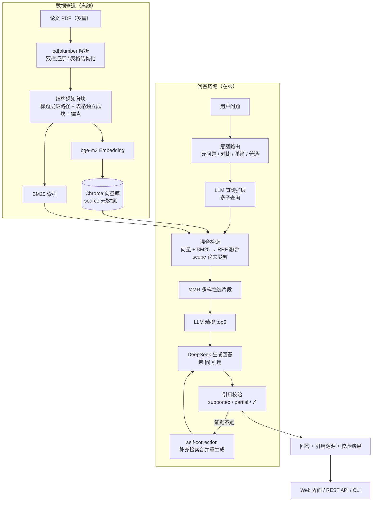

# 论文阅读问答助手（Paper RAG Assistant）

> 基于 RAG（检索增强生成）的论文阅读问答系统：上传论文 PDF 即可针对论文内容多轮问答，回答自带
>
> **引用溯源**
>
> 与
>
> **证据校验**
>
> ；支持多篇论文语料库管理与跨论文对比。

面向 AI 应用开发岗的独立项目，核心解决论文类 PDF 问答的三个实际问题：**结构化表格怎么检索**、**多篇论文怎么隔离不串台**、**跨论文对比怎么保证公平不遗漏**。


***

## 技术栈


| 模块        | 选型                          | 说明                          |
| --------- | --------------------------- | --------------------------- |
| LLM       | DeepSeek API（deepseek-chat） | 问答生成 / LLM 精排 / 引用校验 / 查询扩展 |
| Embedding | Ollama 本地 bge-m3（1024 维）    | 本地部署，中英混合                   |
| 向量库       | ChromaDB（0.6.3）             | 持久化 + metadata 过滤           |
| 稀疏检索      | BM25（rank-bm25）             | 与向量检索做 RRF 混合               |
| PDF 解析    | pdfplumber                  | 按单词坐标还原双栏 / 表格              |
| 服务        | FastAPI + uvicorn           | REST API + 托管 Web 界面        |
| 前端        | 原生 HTML/JS 单页               | 聊天界面 + 引用卡片 + 语料库管理         |


***

## 系统架构





***

## 核心亮点

### 1. 三路意图路由：元问题 / 对比 / 单篇问答

RAG 对 "语料库元问题" 有结构性盲区 —— 论文正文不会写 "我收录了几篇论文"，语义检索只能捞到参考文献区等沾边碎片（实测问 "有几篇论文" 时 NightRain 0 块）。系统按意图分流：


* **元问题通道**：问 "库里有几篇 / 有没有 XX 论文"→ 跳过语义检索，直接按分块元数据 `source` 分组列清单 → 实测 4/4 篇全覆盖、引用全部 supported；每篇给 **3 个信息量最高的代表块**（标题页/摘要/方法），要求逐篇概述**任务/方法/关键数据/与其他论文的关系**（max_tokens 1500），问 "每篇论文都在讲什么" 不再退化成复述标题

* **对比专用链路**：检测对比意图 → 识别问题点名的库内论文（每篇的**独特关键词**，避免 "Raindrop" 这类 3 篇共有的词误点名）→ 对每篇用 "剥离他篇名字" 的子查询 + 单篇作用域检索 → **精排 top10 后每篇至少 1 块进最终**（先每篇保底再按精排补齐，避免名额互相顶替）

* **单篇作用域**：向量检索走 Chroma metadata 过滤（`where={"source": ...}`），保证多篇论文不串台

> 实测：修正前 "对比这四个论文" 把论文里的外部基线（IDT/RDiffusion）误当论文回答、漏掉 2 篇；修正后引用覆盖 
>
> **4/4 篇**
>
> ，且诚实标注 "检索片段中未找到统一数据集上的直接定量对比"—— 不编造。

### 2. 防幻觉闭环：引用校验 + self-correction

回答生成后不是直接交付，而是闭环自检：


* **引用校验（posthoc attribution，OpenScholar 同款）**：逐条核对回答中每个 `[n]` 引用支撑的断言是否真的被对应片段支持，输出 supported /partial/unsupported 与理由；**表格块与 References 块给全文**（截断会把关键数据行、引文列表后部的名字误判为"不支持"——两个真实踩坑）；支持**分类断言**（"这是参考文献列表"、"这是被评估的基线而非提出的方法"——片段性质吻合即 supported，性质不符照拒）

* **self-correction**：校验发现证据不足 → LLM 构造补充查询 → 再检索合并证据 → 重新生成并再校验（最多 1 轮，防无限循环）

* 实测能抓出模型自己的错误：回答把结论误引到公式块时，校验器判 `[4] 不支持`——"数据对，但引用错" 也能识别；回答在 AGAN 段落引用 NightRain 的表格块时，校验器指出"编号与片段内容不符"

### 3. 论文表格结构化（PDF 问答最难啃的骨头）

论文数值表（PSNR/SSIM、排名表）**几乎全是无边框对齐表**，常规 `find_tables()` 检测不到（4 篇论文 18 个表格区域只有 1 个真表）。方案：


1. 按单词坐标做**列对齐启发式**定位候选（关键：双栏拆分防左右栏误并、跨栏合并防宽表被劈）

2. 交给 LLM 判定 "是否真表 + 转 Markdown"（误报如作者列表 / 结构图标签 / 公式由模型兜底过滤）

3. 表格**独立成块**入库，`Table 1.` 说明行并入作检索锚点；引用校验对表格块给**全文**（防关键数据行被截断导致误判）

> 实测：问 "AGAN 完整方法在雨滴数据集上的 PSNR/SSIM" 答出 
>
> **31.57 / 0.9023**
>
> （精确命中 
>
> `Ours (AA+AD)`
>
>  行，区分 A+AD 30.60/0.8710）；问 "NightRain 比 FDM 好多少" 答出 
>
> **PSNR 26.73 vs 23.49、SSIM 0.8647 vs 0.7657**
>
> （表格块，引用 supported）。

### 4. 检索质量三板斧：查询扩展 + MMR + LLM 精排


* **LLM 查询扩展**：检索前把问题扩成多个子查询（专有名词 / 方法名 / 术语同义表述），多路混合检索 + **跨路 RRF 融合**（解决不同查询分数不可比）

* **MMR 多样性**：全库模式下先按论文配额补池（每篇 scope 检索 top2，防 "候选池垄断时 MMR 无米下锅"），再 MMR（相关度 − 与已选片段冗余度，λ=0.7）选多样化的 top8—— 实测 "有哪些去雨方法" 候选从 3/4/3/2 均衡为 **2/2/2/2**

* **LLM 精排**：Ollama 官方无 `/api/rerank` 端点（模型可拉但调用 404，社区均有验证），改用 LLM 对 top20 候选一次性打分重排（paper-qa 同款思路，JSON 输出、单次请求）

### 5. 完整工程化：Web 界面 + 语料库管理


* 单页聊天界面：论文作用域下拉、引用卡片（点击展开片段）、校验徽标（✓/\~/✗）、"自检修正" 提示

* **添加 / 删除论文**：增量入库、上传失败回滚（删块 + 删文件不留脏状态）；解决同进程多 Chroma 客户端互锁（复用同一 collection）

* **会话隔离的多轮记忆**：按 `session_id` 隔离对话历史（QASystem 内部 `session -> history` 字典），每个网页标签/会话独立——follow-up（"那损失函数呢？"）只拼接**本会话**上一轮问题解决省略指代，多用户/多标签互不串台；刷新页面即开新会话；写库后清空全部会话历史（语料变化后旧指代失效）


***

## 量化结果


| 维度    | 结果                                                                                                  |
| ----- | --------------------------------------------------------------------------------------------------- |
| 语料    | 5 篇论文（4 篇雨滴/去雨 + Restormer）→ **220 个分块**（以 `/health` 为准，向量库 / BM25 / 分块缓存三方一致） |
| 跨论文对比 | "对比这四个论文" 引用覆盖 **4/4 篇**（任务 / 方法 / 数据集三层归纳，无外部基线误判）                                                 |
| 元问题   | "这里有几篇论文" 稳定列出全部论文，引用全 supported；"每篇论文都在讲什么" 逐篇概述任务/方法/数据/关系（全覆盖，0 unsupported） |
| 表格问答  | 31.57 / 0.9023（AGAN 表格精确命中）；26.73 / 23.49（NightRain vs FDM）；Restormer 五数据集 33.96 / 0.935 平均                    |
| 论文隔离  | 锁定 AGAN 问 "数据集有什么特点" 只答 1,119 对；锁定 Raindrop Clarity 同问答 15,186 对 —— 互不串台                            |
| 多轮记忆  | "那白天和夜间各多少张？" 正确理解为 5,442 / 9,744                                                                   |
| 防幻觉   | 校验器主动抓出 "片段未直接给出夜间总数（需推断）" 等 partial 引用，不盲信生成引用                                                     |
| 作用域深度 | 同一问题（Restormer 去雨 PSNR）单篇锁定比全库多挖出 2 个细节：单数据集最大提升 2.06 dB、YCbCr Y 通道评测口径                |
| 增量入库  | 上传新论文只重算新块 embedding、BM25 因 IDF 依赖全语料统计而全量重建；上传失败自动回滚（删块 + 删文件）                                  |

### RAGAS 评测（100 样本 Golden Set）

**四组消融对比**（同一代码基线、同一 100 样本，2026-10-29 全量完成）：

| 组 | 配置 | 答案准确率 | faithfulness | answer_relevancy | context_precision | context_recall |
| --- | --- | --- | --- | --- | --- | --- |
| **full（完整版）** | RRF 混合 + MMR + 查询扩展 | **93.0%** | 0.9519 | 0.8810 | 0.6142 | 0.9150 |
| no_mmr | 关 MMR（RRF → 直接精排） | 91.0% | 0.9572 | 0.8737 | 0.5868 | 0.9150 |
| no_expand | 关查询扩展（单路检索） | 89.0% | 0.9614 | 0.8074 | 0.5422 | 0.8333 |
| vector_only | 仅向量（无 BM25，RRF 退化为纯向量排名） | 90.0% | 0.9626 | 0.8664 | 0.5789 | 0.8925 |

> no_expand 组 ragas 有效样本 45-47（该组部分样本上下文未命中 ragas 指标计算所需字段，见 `eval_summary_no_expand.json` effective_n）。

**自研组件增量贡献（消融结论）**：
- **查询扩展 → +4.0 个点**（93.0 vs 89.0）：LLM 生成子查询扩召回的价值最大，relevancy/precision/recall 全面上升；
- **RRF 跨路融合（BM25+向量）→ +3.0 个点**（93.0 vs 90.0）：双路互补优于纯向量单路；
- **MMR 多样性 → +2.0 个点**（93.0 vs 91.0）：去冗余后精排上游上下文更聚焦，precision 提升最明显（0.6142 vs 0.5868）；
- 三个组件全开时效果最好（93.0%），全部超出验收线 ≥80%；faithfulness 均 >0.95（幻觉率 <5%）。

**无 RAG 基线（对照组，2026-10-29）**：

| 组 | 配置 | 答案准确率 |
| --- | --- | --- |
| no_rag | 跳过检索，纯 LLM 直接回答（`--no-rag` FakeQA，100 题） | **1.0%**（1/100）|

> 99/100 题模型诚实输出"无法确定"（提示词明确要求不确定时不得编造）——证明 Golden Set 是真正依赖论文检索的细粒度问题集（数据集具体数字、表格数值、专有名词、方法细节），不是靠模型记忆能过的题。**RAG 管线整体贡献 +92.0 个点**（93.0% vs 1.0%）；三个自研组件的增量（+2~+4 个点）是建立在"检索链路本身就有决定性价值"之上的优化增益。

**按问题类别拆解（组件价值在目标场景显著放大）**：

| 类别（题数） | full | no_mmr | no_expand | vector_only |
| --- | --- | --- | --- | --- |
| 数据集（26） | 26/26 | 26/26 | 25/26 | 26/26 |
| 方法（20） | 20/20 | 20/20 | 19/20 | 20/20 |
| 夜间去雨（20） | 19/20 | 18/20 | 17/20 | 17/20 |
| 挑战赛（16） | 14/16 | 15/16 | 14/16 | 14/16 |
| **全库对比/元问题（18）** | **14/18** | **12/18** | 14/18 | 13/18 |
| 总计（100） | **93/100** | 91/100 | 89/100 | 90/100 |

- **MMR 的价值集中在全库对比类**（14/18 vs 12/18，+11.1%）：它救回的 4 道题里 3 道是全库枚举问题（"哪些论文提出了新数据集？""哪些是方法/数据集？"）——正是 MMR 的设计场景（跨论文对比防候选被少数论文垄断）；
- **查询扩展的价值集中在术语密集类**（夜间去雨 19/20 vs 17/20；救回 SynNightRain 规模、NTIRE 排名算法、遮挡类型等专有名词题）；
- 挑战赛类出现 1 题反向波动（full 14/16 < no_mmr 15/16），属 LLM 生成噪声——单次运行差异 1~2 题在随机性范围内，结论以类别整体趋势 + 证据样本为准。

> 说明：早期 10-23 曾测得 96.0% / 0.9451，为当时代码版本发布值；消融四组为 10-29 同一轮次内互比（会话隔离等代码演进 + LLM 生成波动导致绝对数与旧值有差），结论以同轮互比为准。

> 评测方式：`eval/run_eval.py` 三阶段解耦 —— ask（真实链路问答落盘）→ judge（DeepSeek 判分）→ ragas（faithfulness/relevancy/precision/recall），支持 `--tag` 输出隔离、断点续跑与 `--skip-ask` 复用样本；评测客户端显式 `timeout=120`、ask 单样本容错（失败跳过不崩整组）。四组驱动见 `scripts/run_ablation.py`，完整明细见 `eval/results/`。


***

## 快速开始


```
# 1. 环境（Python 3.10）
conda create -n paper_rag python=3.10 -y && conda activate paper_rag
pip install -r requirements.txt

# 2. 配置（LLM Key 二选一：DeepSeek API / 本地 Ollama）
copy .env.example .env        # 填 LLM_API_KEY，或已配置系统环境变量 Deepseek_Key
# 本地模式：LLM_PROVIDER=local、LLM_BASE_URL=http://localhost:11434/v1、LLM_MODEL=qwen3:8b

# 3. 放入论文 PDF（data/papers/，支持多篇）+ 启动 Ollama（bge-m3）

# 4. 数据管道 + 验证 + 问答
python src/ingest.py
python scripts/verify_retrieval.py
python scripts/ask.py "夜间雨滴去除的难点是什么？"

# 5. Web 界面
python -m uvicorn api.main:app --port 8000    # 打开 http://127.0.0.1:8000
```

CLI 交互模式：`/papers` 列出论文、`/paper <关键词>` 锁定单篇、`/all` 全库对比、`/reset` 清空历史。

### Docker 一键启动（可选）

前置：宿主机已装并启动 **Ollama**（拉好 `bge-m3` 模型）、已配置 **DeepSeek Key**（`.env` 或系统环境变量）。

```
docker compose up --build -d     # 构建并启动，打开 http://localhost:8000
docker compose down              # 停止
```

- 容器经 `host.docker.internal:11434` 访问宿主机的 Ollama（embedding 仍走本地，不占 API 额度）
- `./data` 目录挂载进容器：论文 PDF / 向量库 / BM25 索引与裸机部署共用，无需重建索引
- 镜像只装运行时依赖（`requirements-runtime.txt`）；评测依赖（ragas/datasets）留在本地 conda 环境


***

## 目录结构


```
├── data/papers/          # 论文 PDF
├── src/
│   ├── parser/           # PDF 解析 + 结构感知分块 + 表格结构化（双栏 / 无边框表）
│   ├── retrieval/        # Chroma 向量库 + BM25 + RRF 混合 + MMR + LLM 精排
│   └── qa/               # 意图路由 + 查询扩展 + 生成 + 引用校验 + self-correction
├── api/main.py           # FastAPI 接口（问答 / 上传 / 删除论文）
├── web/index.html        # 单页聊天界面
├── scripts/              # CLI 问答 / 检索验证 / 分块诊断
└── docs/开发日志.md        # 完整开发过程与 19 条踩坑记录（面试可深挖）
```


***

## Roadmap


* [x] M1 数据管道 / M2 混合检索问答 / 表格结构化 / Rerank / 引用校验 /self-correction/ 查询扩展 / 元问题通道 / MMR / 对比专用链路 / Web 界面与语料库管理

* [ ] M3 写作助手：基于库内论文生成综述段落、润色、参考文献格式化

* [ ] M4 Docker 部署 + 接入更多论文语料

> 详细开发过程（含 19 条踩坑记录、每轮实测）见 
>
> [docs/开发日志.md](docs/开发日志.md)
>
> 。